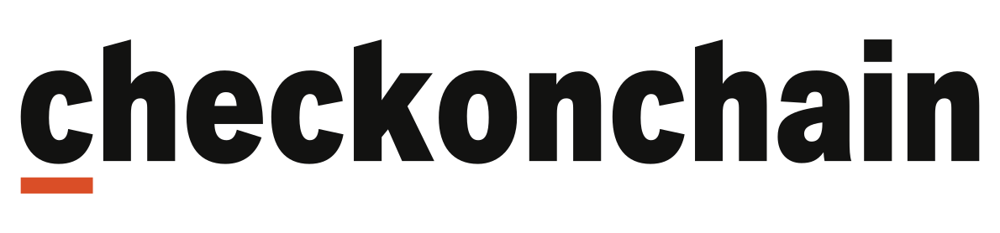
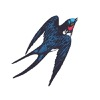

# Bitview and the Bitcoin Research Kit

[](https://crates.io/crates/bitviewd)

Bitview is a free, open-source Bitcoin data server: on-chain metrics, blocks, mempool and mining data, with charts and an API, at [bitview.space](https://bitview.space) or beside your own Bitcoin Core node.

- **Bitcoin Research Kit (BRK):** reusable Rust primitives for reading Bitcoin
  Core data, RPC, mempool tracking, storage, domain types, and the on-chain
  price oracle.
- **Bitview:** the self-hostable application that composes BRK with a typed
  indexer and analytics plugin graph, query layer, REST server, website, and
  generated clients.

<!-- used by -->
**Used by**

<a href="https://sparrowwallet.com/"><picture><source media="(prefers-color-scheme: dark)" srcset="../website/assets/used-by/sparrowwallet-dark.png" /></picture> Sparrow Wallet</a>&emsp;
<a href="https://www.lookintobitcoin.com/"><picture><source media="(prefers-color-scheme: dark)" srcset="../website/assets/used-by/lookintobitcoin-dark.png" /></picture></a>&emsp;
<a href="https://www.checkonchain.com/"><picture><source media="(prefers-color-scheme: dark)" srcset="../website/assets/used-by/checkonchain-dark.svg" /></picture></a>&emsp;
<a href="https://newhedge.io/"><picture><source media="(prefers-color-scheme: dark)" srcset="../website/assets/used-by/newhedge-dark.svg" /></picture></a>&emsp;
<a href="https://thebitcoinlayer.com/"><picture><source media="(prefers-color-scheme: dark)" srcset="../website/assets/used-by/thebitcoinlayer-dark.png" /></picture></a>&emsp;
<a href="https://qfilabs.substack.com/"> QFI Labs</a>&emsp;
<a href="https://papanglabs.com/"><picture><source media="(prefers-color-scheme: dark)" srcset="../website/assets/used-by/papanglabs-dark.svg" /></picture> Papang Labs</a>&emsp;
<a href="https://atreidis.app/"> Atreidis</a>
<!-- /used by -->

See [Architecture](./ARCHITECTURE.md) for the component and data-flow details.

## Repository map

| Path | Purpose |
|---|---|
| `crates/brk_*` | Reusable Bitcoin primitives |
| `crates/bitview_plugin_*` | Official indexing and analytics plugins |
| `crates/bitview*` | Plugin contract, runtime, composition, query/server stack, daemon, code generation, and Rust clients |
| `crates/{vecdb,rawdb,byteview,fjall,lsm-tree}` | Storage and data infrastructure |
| [`examples/custom_plugin`](../examples/custom_plugin) | Runnable external-plugin and custom-composition example |
| [`modules/bitview-client`](../modules/bitview-client) | JavaScript/TypeScript client |
| [`packages/bitview_client`](../packages/bitview_client) | Python client |
| `website` | The site: its front page, Studio and apps, served by the server |
| `docs`, `benches`, `docker`, and `scripts` | Project documentation, measurements, packaging, and maintenance tooling |

## Use Bitview

The hosted website, API, and MCP endpoint require no account or authentication:

- [Bitview](https://bitview.space), its front page, Studio and apps
- [Interactive API](https://bitview.space/api)
- [OpenAPI](https://bitview.space/openapi.json)
- MCP client endpoint: `https://bitview.space/mcp`
- [CLI](https://crates.io/crates/bitview_cli)
- [JavaScript](https://www.npmjs.com/package/bitview-client)
- [Python](https://pypi.org/project/bitview-client)
- [Rust](https://crates.io/crates/bitview_client)

```bash
curl https://bitview.space/api/oracle/price
curl https://bitview.space/api/series/count
```

Find series identifiers with `/api/series/search?q=<concept>`.

## Self-host Bitview

```bash
rustup update && RUSTFLAGS="-C target-cpu=native" cargo install --locked bitviewd
bitviewd
```

The default composition needs Linux or macOS, a mainnet Bitcoin Core node with
RPC and complete `blk*.dat` files from genesis, about 290 GiB for Bitview plus
Bitcoin Core storage and growth headroom, and 16 GB of RAM recommended for a
full sync. The website and API are served at [localhost:3110](http://localhost:3110),
to this machine only unless `serverbind` says otherwise.

See the [`bitviewd` guide](../crates/bitviewd) for requirements, disk usage,
installation, configuration, initial sync, and custom compositions.

## Build with BRK

```toml
[dependencies]
brk_reader = "0.12"
brk_rpc = "0.12"
brk_types = "0.12"
```

For a new Bitview metric or composition, start with the
[custom plugin example](../examples/custom_plugin) and the
[`bitview_plugin` contract](../crates/bitview_plugin).

## Develop

The repository pins its Rust toolchain in `rust-toolchain.toml`.

```bash
cargo check --workspace
cargo api   # records the API snapshots
cargo bindgen   # regenerates the clients
```

## Documentation

- [Changelog](./CHANGELOG.md)
- [Professional hosting](./PROFESSIONAL_HOSTING.md)

## Support and community

BRK is supported by [OpenSats](https://opensats.org/) from December 2024 through
June 2027.

[Discord](https://discord.gg/WACpShCB7M) ·
[X](https://x.com/_nym21_) ·
[Issues](https://github.com/bitcoinresearchkit/mono/issues) ·
[Support](mailto:support@bitview.space)

### Donations

<a href="https://x.com/_Checkmatey_"></a>
<a href="https://x.com/JohanMBergman"></a>
<a href="https://x.com/alonshvartsman"></a>
<a href="https://x.com/clearmined1"></a>
<a href="https://x.com/PositiveCrypto"></a>


[`bc1pkqvzn3pepug695xtvwmpm0sjd6n9j55v792cwfruzkqzrf2jn47s3hq0ts`](bitcoin:bc1pkqvzn3pepug695xtvwmpm0sjd6n9j55v792cwfruzkqzrf2jn47s3hq0ts)

## License

[MIT](../LICENSE)
